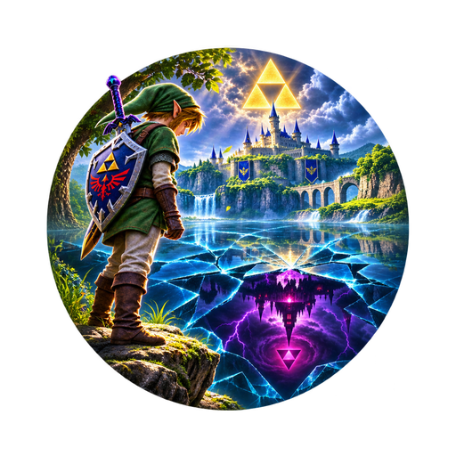

# Shattered Dimensions

**A native Windows PC engine for A Link Between Worlds.**

Shattered Dimensions is an unofficial, native Windows PC engine that runs The Legend of Zelda: A Link Between Worlds from your own cartridge: high resolutions, widescreen, modern controls and enhanced textures.

> **Unofficial project.** Shattered Dimensions is an unofficial fan project. It is not affiliated with, endorsed or supported by Nintendo. It contains no game data: you need your own lawfully obtained copy of The Legend of Zelda: A Link Between Worlds (USA). Nintendo, The Legend of Zelda and A Link Between Worlds are trademarks of their owners.

## Download

Version 1.0 has not been released yet. When it is, it is published on the [Releases page](https://github.com/zeref843/shattered-dimensions-updates/releases) of this repository, as one zip file with its SHA-256 checksum, and on [shattereddimensions.com](https://shattereddimensions.com).
Only download Shattered Dimensions from those two places: copies from anywhere else are not ours, are not signed, and will not receive updates. What you need, and how to install it: [the download guide](docs/download.md).

## What version 1.0 includes

- **A native Windows engine** that runs the game from your own cartridge dump, translated and built on your PC by the setup.
- **High resolutions,** up to 6 times the original inside the game, in a window, borderless or full screen, at 60 frames a second or matched to your screen.
- **Widescreen 16:9** that shows more of the world, or the original 5:3.
- **One screen:** the live minimap in a corner, the map, Items and Gear as panels, the hearts, rupees and energy gauge rearranged for one screen.
- **Choosing items your way:** hold a button, a radial wheel, or the classic window.
- **Keyboard, mouse and controllers,** fully remappable, with on-screen buttons that follow the device you use.
- **HD and 4K textures** from our own upscaler, and a sharp map and menus at any resolution.
- **Texture packs,** including packs made for 3DS emulators, and packs that restyle the new interface.
- **Ray-traced shadows** and **DLSS Frame Generation** on graphics cards that support them.
- **Safe saves:** written completely or not at all, kept and backed up through every update.
- **Signed updates** offered on the start screen.

## Everything else

| | |
|---|---|
| [The handbook](docs/handbook/README.md) | Getting started, graphics, controls, texture packs, troubleshooting |
| [Support](SUPPORT.md) | Fixes for common problems, and how to report a bug |
| [Updates](UPDATES.md) | Versions, known issues and what comes next |
| [Coming soon](COMING_SOON.md) | Plans for the community (none of them exist yet) |
| [The team](TEAM.md) | Who built Shattered Dimensions, and how |
| [Licences and credits](CREDITS.md) | Our licence, what is ours, and the work of others we use |
| [Security](SECURITY.md) | How to report a security problem privately |
| [Website](https://shattereddimensions.com) | shattereddimensions.com |

## About this repository

This repository holds the releases of Shattered Dimensions, its player documentation, and its bug reports. The source code of Shattered Dimensions is not public. Please never attach or link game files, keys or saves from other people in an issue.

## Licence

Shattered Dimensions is freeware: free to download and use, all rights reserved. See [LICENSE](LICENSE) and [Licences and credits](CREDITS.md).
